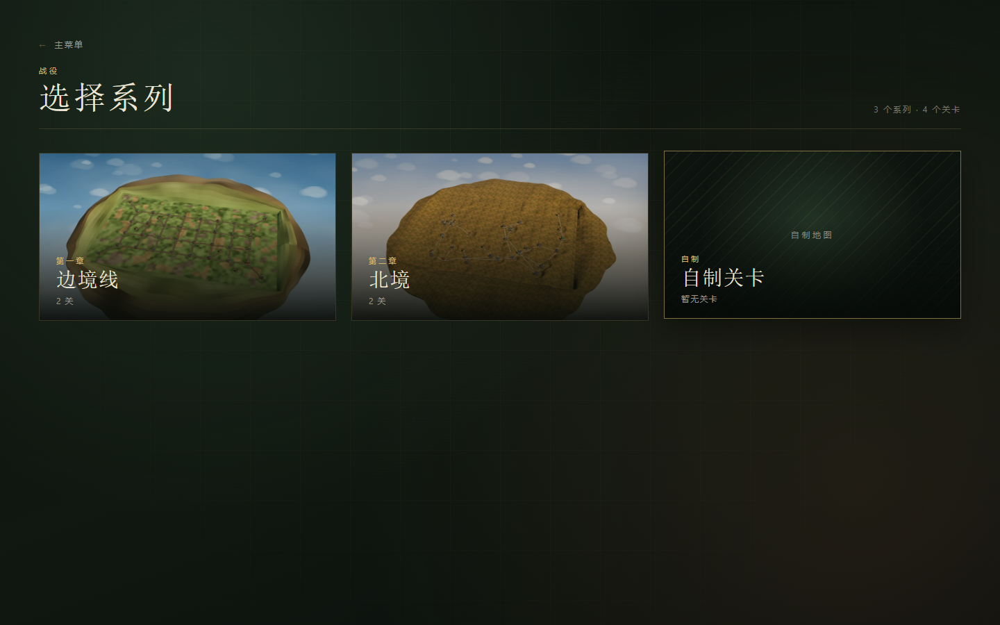
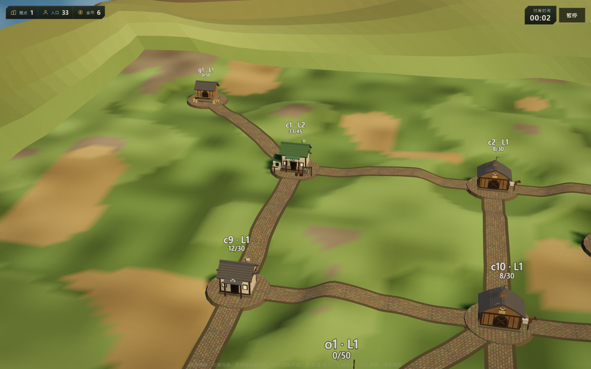
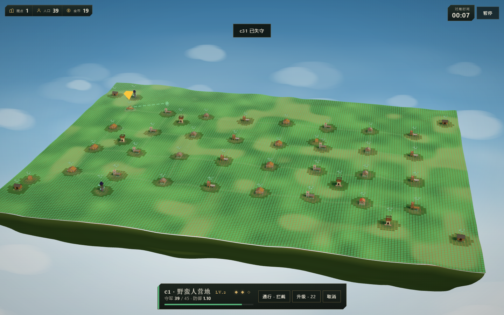
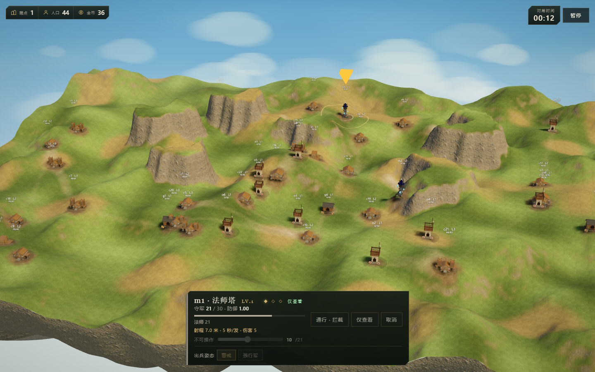
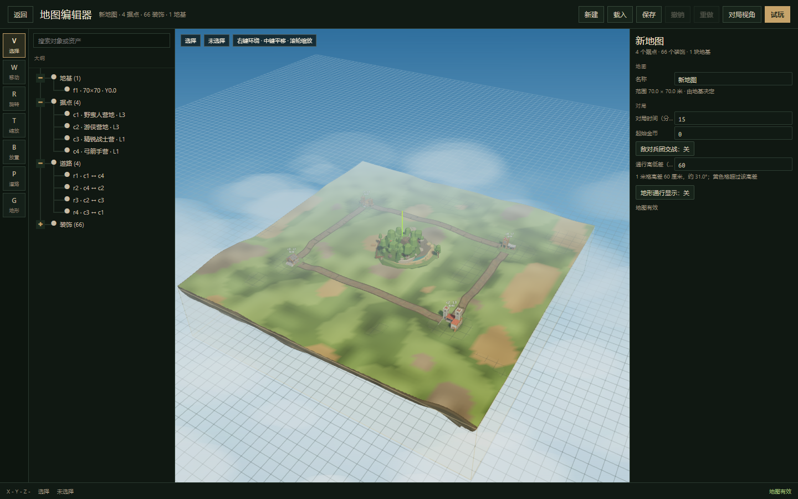

# Marchlands 边境之地


## 简介

Marchlands 是一款 3D 领地争夺游戏。玩家从一座产兵据点起步，派兵沿道路与地形推进，占领中立城镇与敌方据点，在 15 分钟内拿下整张地图。

游戏由 Three.js 客户端、Electron 桌面外壳和确定性 TypeScript 模拟核心组成。模拟以 20 Hz 固定步长运行，所有指令、寻路和战斗都可重放并校验状态哈希。

## 下载

Windows 10 或 Windows 11，x64。

[v0.2.4 发布包](https://github.com/HuoGu-Hub/Marchlands/releases/tag/v0.2.4)

下载后解压，运行 `Marchlands.exe`。无需安装，存档与设置保存在本机浏览器存储中。

## 0.2.4 更新

- 法师塔改为固定等级与范围法术攻击，攻击表现改为火红激光。
- 修复法师塔火球落点、可见性，以及中立法师塔不攻击的问题。
- 可以查看非己方建筑信息，并显示可攻击建筑的射程范围。
- 优化后期据点绘制、镜头外渲染、状态克隆与寻路缓存。
- 修复可达范围显示染上崖壁的问题。
- 补充法师塔攻击与射程显示的端到端测试。

## 0.2.3 更新

- 地基与地形改为连续显示面，替换格子台阶与纸片崖壁，台地边缘和坡道衔接更自然。
- 通行判定改为纯坡度，格子尺寸变化会自动换算，不再依赖台阶或崖壁格。
- 坡道两侧台面按 70 厘米一级放坡，路边不再出现孤立崖顶和侧壁。
- 地形笔刷拖动只刷新局部网格，单帧 p90 从约 205 毫秒降到约 11 毫秒。
- 松手后的整张地形重建从约 300 毫秒降到 50 到 70 毫秒。
- 兵团增加警戒与强行军姿态，遭遇后警戒方停下交战。
- 粮仓与驻兵点可以派驻军并按兵种记录，派兵数量可用滑块调整并记住比例。
- 六张官方地图重新烘焙地形与缩略图。

## 0.2.2 更新

- 指示箭头与派兵落点改为按真实高度场拾取，陡壁、台地和坡道上的落点不再偏移。
- 路线预览改为绘制实际网格路径，看到的路线与出兵后行走的格子一致。
- 建筑模型改为等待异步落位后再结束准备画面，减少开局进入对局时的卡顿。
- 客户端主包从约 13.8 MB 降到约 2.0 MB，模型改为独立资源并行加载。
- 地形增加陡壁墙面与三平面细节，台地边缘的岩壁更完整。
- 编辑器新增网格分辨率与兵种可达性预览，可以按兵种查看能走到的范围。
- 六张官方地图的缩略图与地形细节同步更新。

## 0.2.0 更新

- 地基系统重做：地基铺满整图，台地按层抬升，台地边缘生成不可攀爬的竖直岩壁。
- 新增层高、陡壁与坡道编辑工具，台地只能通过坡道进入。
- 地表与路面合并为整张烘焙贴图，路面、院落和岩壁随地形一起绘制。
- 六张官方地图重新铺设一格宽道路，据点圆盘改为不规则泥地院落。
- 选中建筑后单击目的地会显示行军路线预览，不会直接派兵。
- 岩脊高地地形重做，加入明显的台地、岩壁与坡道高差。

## 玩法

- 每个据点按等级产生人口与金币。人口达到升级消耗后可以升级，提高人口上限、防御与收入。
- 派兵消耗当前人口的一半，兵团沿网格寻路前往目标。抵达敌方据点后按攻防结算，守方人口清零则占领。
- 粮仓提供人口容量、攻防与行军速度加成。驻兵点可以驻军，也可以切换迎战或避战。
- 兵团携带粮草。长途行军需要规划粮仓与驻兵点，断粮会持续减员。
- 行军途中可以改道，点击暗色路线选择下一跳，或点击据点更换目的地。
- 胜利条件为占领全部城镇，或 15 分钟结束时城镇数、总人口、金币依次比较。

## 内容

- 6 张官方地图，战役包含两章 4 个关卡。
- 6 个兵种：野蛮人、精锐战士、游侠、弓箭手、法师、骑兵。
- 3 档 AI 难度：轻松、标准、困难。
- 地图编辑器支持网格地形、道路、装饰、地基、层高、陡壁、坡道、资产包导入导出、校验、撤销与试玩。
- 6 套兵种皮肤，可在主菜单切换，敌我双方共用模型并按队伍色区分。

## 操作

| 操作 | 按键 |
| --- | --- |
| 旋转镜头 | Q / E |
| 缩放 | 滚轮 |
| 拖动地图 | 按住左键拖动 |
| 选择据点 | 左键点击 |
| 多选据点 | Ctrl + 左键 |
| 派兵 | 双击据点，或从据点拖拽到目标 |
| 兵团改道 | 选中兵团后点击暗色路线 |
| 取消选择 | 右键 |
| 暂停 | Esc |

## 截图











## 从源码运行

环境要求：Node.js 20 或更高，pnpm 11。

```bash
pnpm install
pnpm dev
```

客户端默认地址为 http://127.0.0.1:5188。开发模式下可以用 `?speed=20` 加速模拟，用 `?scene=frontier-battle&map=crossroads01` 直接进入指定地图的对局，用 `?scene=height` 打开高低差测试场景。

对局内右上角的“DEV 调参”或 F2 可以打开开发数值面板，实时调整兵种属性、建筑规则与全局参数。调完点“导出 balance.json”，替换 `packages/sim/src/balance.json` 后重新构建，发版读取的就是这份文件；面板本身不会写入发布包。

## 构建 Windows 客户端

```bash
pnpm --filter @marchlands/client build
pnpm package:win
```

产物位于 `release/Marchlands-win32-x64/Marchlands.exe`。

如果本机设置了 `ELECTRON_RUN_AS_NODE=1`，启动 Electron 前需要清除该变量。

## 仓库结构

| 路径 | 内容 |
| --- | --- |
| `apps/client` | Three.js 客户端、页面、编辑器与 Electron 外壳 |
| `packages/sim` | 确定性模拟、寻路、战斗、经济与 AI |
| `packages/content` | 官方地图、规则与内容校验 |
| `packages/nav` | 1 米网格、A*、坡度与单位占地 |
| `packages/map-authoring` | 地图文档、编译、地形与网格编辑 |
| `packages/asset-pack` | `.mlpack` 资产包格式 |
| `tools/harness` | AI 自对弈与回放校验 |
| `tools/map-export` | 官方地图构建脚本 |
| `tools/asset-convert` | 模型转换脚本 |
| `tests/e2e` | Playwright 页面流程测试 |
| `docs` | 开发指南、页面流程、ADR 与系统设计 |

## 测试

```bash
pnpm typecheck
pnpm test
pnpm test:e2e
```

`pnpm test` 覆盖模拟、内容、导航、地图文档、资产包和自对弈。`pnpm test:e2e` 需要本机安装 Chrome，并由 Playwright 自动启动开发服务器。

## 文档

- [开发指南](docs/Marchlands-开发指南.md)
- [页面流程](docs/page-flow.md)
- [资产包格式](docs/Marchlands-资产包.md)
- [地形高度与寻路](docs/Marchlands-地形高度与寻路.md)
- [网格导航](docs/Marchlands-网格导航.md)
- [渲染决策](docs/adr/0001-renderer.md)
- [粮仓与驻兵点](docs/adr/0002-granary-outpost.md)
- [行军改道与粮草](docs/adr/0003-squad-reroute-supply.md)

## 素材与许可

除第三方素材外，项目代码以 MIT 许可发布，见 [LICENSE](LICENSE)。

外部模型、贴图与音效来自 Kenney、KayKit、Quaternius 与 Sketchfab，许可为 CC0 或 CC BY 4.0。完整清单、作者与来源见 [ASSETS.md](ASSETS.md)。CC BY 素材已写入游戏内设置页的素材署名。

## 版本

当前版本 0.2.4。

已知限制：仅提供 Windows x64 构建，单机对 AI，界面为简体中文，暂未加入联机、战争迷雾与正式关卡平衡。