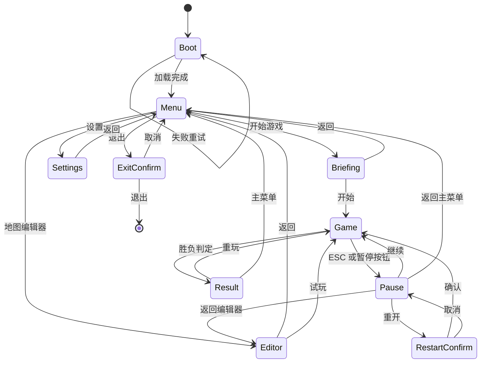

# 页面流程

## 图

## 页面内容

| 页面 | 元素 | 出口 |
|---|---|---|
| Boot | Logo、加载条、版本号；失败时错误码与重试 | Menu |
| Menu | 标题、开始游戏、地图编辑器、设置、退出 | Briefing、Editor、Settings、ExitConfirm |
| Briefing | 地图名、地图选择、载入地图文件、三行目标、开始、返回 | Game、Menu |
| Editor | 调色板、3D 视口、地图设置、据点属性、诊断、保存/载入、试玩 | Menu、Game |
| Game | 顶部资源条、计时、暂停；底部选中城面板；场景内城与队伍 | Pause、Result |
| Pause | 继续、重开、返回主菜单；重开二次确认 | Game、RestartConfirm、Menu |
| Result | 胜利或失败、城市数、人口、金币、用时、重玩、主菜单 | Game、Menu |
| Settings | 分辨率、窗口模式、主音量、语言占位、保存、返回 | Menu |
| ExitConfirm | 取消、退出 | Menu、桌面 |

## ESC 规则

| 当前页面 | ESC 行为 |
|---|---|
| Game | 打开 Pause |
| Pause | 继续游戏 |
| RestartConfirm | 取消，回到 Pause |
| Settings | 保存并返回 Menu |
| ExitConfirm | 取消，回到 Menu |
| Result | 无操作 |
| Briefing | 返回 Menu |
| Editor | 清除当前选择与工具，不退出页面 |
| Boot | 无操作 |

## 状态约束

- 进入 Game 时创建新对局，旧状态全部丢弃。
- Pause 只冻结模拟与计时，不冻结 UI 动画。
- 从 Pause 返回 Menu 前必须停止模拟并清空计时。
- 编辑器草稿自动保存；试玩暂停后返回编辑器，草稿与镜头保留。
- 自定义地图保存为 MapDocument，可在简报中载入并进入对局。
- Result 出现后模拟停止，只允许重玩或回主菜单。
- 设置写入本地存储，重开游戏不丢。
- 任何页面都禁止出现无响应按钮。
