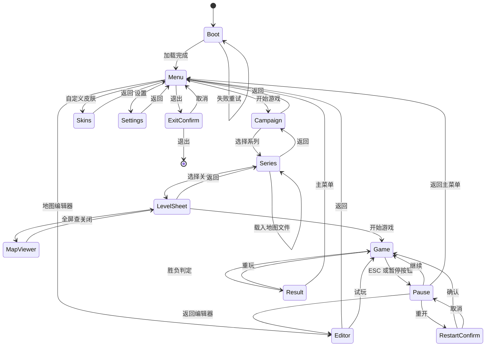

# 页面流程

## 图

## 页面内容

| 页面 | 元素 | 出口 |
|---|---|---|
| Boot | Logo、加载条、版本号；失败时错误码与重试 | Menu |
| Menu | 标题、开始游戏、自定义皮肤、地图编辑器、设置、退出 | Campaign、Skins、Editor、Settings、ExitConfirm |
| Campaign | 系列卡片：章节、系列名、关卡数、首关封面；含自制关卡系列 | Series、Menu |
| Series | 关卡卡片：关卡名、产兵据点数、时限、地图缩略图；自制系列提供载入地图文件 | LevelSheet、Campaign |
| LevelSheet | 地图预览、系列与关卡名、目标、时限、难度选择、开始游戏、全屏查看、返回 | Game、Series、MapViewer |
| MapViewer | 当前关卡地图的全屏预览 | LevelSheet |
| Editor | 调色板、3D 视口、地形/装饰资产、地图设置、据点与装饰属性、诊断、资产包导入、保存/载入、试玩 | Menu、Game |
| Game | 顶部资源条、计时、暂停；底部选中城面板；场景内城与队伍 | Pause、Result |
| Pause | 继续、重开、返回主菜单；重开二次确认 | Game、RestartConfirm、Menu |
| Result | 胜利或失败、城市数、人口、金币、用时、重玩、主菜单 | Game、Menu |
| Skins | 五个兵种页签；每套皮肤的正面照卡片、使用中标记、恢复默认 | Menu |
| Settings | 分辨率、窗口模式、主音量、语言占位、保存、返回 | Menu |
| ExitConfirm | 取消、退出 | Menu、桌面 |

## ESC 规则

| 当前页面 | ESC 行为 |
|---|---|
| Game | 打开 Pause |
| Pause | 继续游戏 |
| RestartConfirm | 取消，回到 Pause |
| Campaign | 返回 Menu |
| Series | 返回 Campaign |
| LevelSheet | 关闭，回到 Series |
| MapViewer | 关闭，回到 LevelSheet |
| Settings | 保存并返回 Menu |
| Skins | 返回 Menu |
| ExitConfirm | 取消，回到 Menu |
| Result | 无操作 |
| Editor | 清除当前选择与工具，不退出页面 |
| Boot | 无操作 |

## 状态约束

- 进入 Game 时创建新对局，旧状态全部丢弃。
- 对局开始先播 3.6 秒倒计时，镜头从整张地图推近到己方起始据点；点击或滚轮可跳过。
- 关卡选择先选系列，再选关卡；关卡详情内选择本局难度并查看地图全屏预览。
- 难度写入本地存储，下一次打开关卡详情沿用上次选择。
- 兵团皮肤在首页“自定义皮肤”页按兵种选择，卡片直接展示正面照；点选即写入本地存储。
- 皮肤卡片图位于 public/skins/<key>.png；新增皮肤后运行 pnpm portraits 批量生成。
- 系列由 `campaign.ts` 定义；新增地图时补一条关卡，运行 `pnpm previews <mapId>` 生成 `previews/<mapId>.jpg`。
- 自制地图保存为 MapDocument，归入自制关卡系列，卡片使用战术示意图预览。
- 地图视觉层与资产包只影响画面；缺失资产不阻止开始对局。
- Result 出现后模拟停止，只允许重玩或回主菜单。
- 设置写入本地存储，重开游戏不丢。
- 任何页面都禁止出现无响应按钮。
